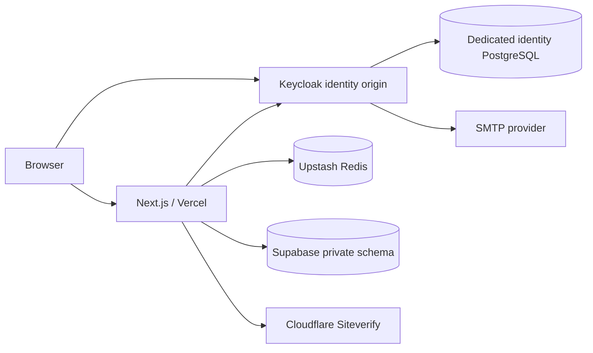

# Architecture and security boundaries

The Next.js website runs on Vercel. Keycloak 26.8.0 runs as a separate persistent container with a dedicated PostgreSQL database. Supabase PostgreSQL stores only business data. Upstash stores opaque application sessions, OAuth transactions, refresh locks and rate counters. Passwords, MFA secrets, recovery and identity lifecycle stay in Keycloak.

## Identity

`openid-client` performs discovery, Authorization Code exchange, PKCE S256, state, nonce, issuer/audience/expiry checks, and ID-token signature verification (`enableNonRepudiationChecks`). Exact configured callback and host are used; arbitrary forwarded origins are not accepted. OIDC browser clients have direct access/password grants, implicit flows and service accounts disabled. The local operator helper uses Keycloak's administrative `admin-cli` token mechanism only, never an application login or stored business password.

The browser gets an unpredictable opaque session identifier. Production cookies are Secure, HttpOnly, SameSite=Lax, host-only `__Host-` cookies. OAuth tokens live only in Redis. Sign-in transactions expire in five minutes and are atomically consumed. Session IDs rotate at login. Sessions expire absolutely after eight hours; Keycloak idle/max lifetimes may end them sooner.

Refresh uses a Redis ownership lock and rereads state after acquiring it. A competing request receives a retryable unavailable response. Refresh failure deletes the session. Each protected access introspects the access token, checking active status, issuer, subject and its own client audience. Identity/Redis outages fail closed. ID tokens are never used as API bearer tokens.

Local logout clears the application session and attempts refresh-token revocation. Central logout uses the supported RP-initiated end-session flow with client ID and exact registered post-logout URI, avoiding tokens in URLs. It ends the current central SSO session after confirmation, not all devices universally. Keycloak's account console lists and revokes other sessions. Already-issued tokens in other apps may last until expiry (120 seconds in the supplied realm). Consent revocation is separate from session revocation and does not promise immediate invalidation of all issued tokens.

All new users must enroll OTP. The browser flow requires a second factor, with supported OTP and recovery-code alternatives. The custom password-reset flow preserves existing factors and requires one after email recovery; possession of a reset email alone does not bypass MFA. Shared configuration scripts apply these settings to local and production realms. Verify them on the real identity deployment before admin provisioning. Admin rights are a Keycloak **client role**, never a profile field. The bootstrap script checks the exact subject, verified email, active identity, and OTP credential and revokes existing sessions. `requireAdmin` checks the role returned by live introspection. Role changes require session revocation to invalidate old role-bearing tokens promptly.

## Business data

`behind_private` is unexposed and grants no PUBLIC, anon or authenticated schema access. No browser Supabase client or service-role key exists. There are no tables in an exposed schema. RLS is not used as a substitute for authorization: the server-side DAL checks session/ownership on every operation. Never expose this schema through PostgREST. SQL injection is prevented with parameterized Drizzle/Postgres queries and Zod input validation.

A unique `(issuer, subject)` pair maps to a local UUID. Email is never an immutable ID or a merge key. Preferences reference that UUID. Authenticated inquiries link to it; anonymous inquiries remain unlinked. Contact payloads have server-side length limits, topic constraints, an idempotency UUID and payload digest. Each retry requires fresh CAPTCHA; matching retries return success only after an existing matching persisted row is found. Contact success does not imply an email was sent: staff review persisted inquiries.

Runtime access is limited to business-table CRUD and audit insertion. It cannot create schema objects, bypass RLS, read audit records, or use migration credentials. The server uses small pools and disables prepared statements for the Supabase transaction pooler. TLS certificate verification is enabled outside local development.

## Export and deletion

Export and website-data deletion require a current session authenticated within five minutes. Export contains the local profile/preferences, linked inquiries, and basic identity details, never tokens/credentials. Sensitive identity settings use the supported account console.

Deletion is deliberately explicit: remove website business records; then use Keycloak's supported self-service deletion, which requires reauthentication. Cancellation of the second step leaves the identity active. Anonymous inquiries are not automatically matched by email. Other apps handle their own records. If a user deletes directly in Keycloak, the operator reconciliation worker removes linked business records only after two authenticated missing-identity checks at least 24 hours apart. Timeouts, authorization failures and server errors preserve data. This worker is implemented and locally tested; scheduling and a restricted production operator credential remain launch requirements. It is not a real-time cross-system event listener.

## Web security and caching

Mutations require exact Origin, validated content type and bounded body bytes. Per-request nonce CSP protects script execution, with Turnstile loaded only on the contact page. Style inline allowances support React/Motion; no arbitrary user HTML is rendered. Security headers disable framing, content sniffing, camera, microphone and geolocation. Personalized pages and APIs are no-store. Hashed public JS/CSS/fonts are immutable-cacheable. Public HTML is dynamically rendered for fresh CSP nonces rather than shared-cached; no performance claim assumes a cached HTML response.

Staging requires application HTTP Basic protection plus recommended Vercel Deployment Protection. Production/staging startup rejects missing secrets, local/example origins, development client flags, test Turnstile keys, privileged DB users and marked development secrets. No public release or automatic Git deployment is enabled in `vercel.json`.
